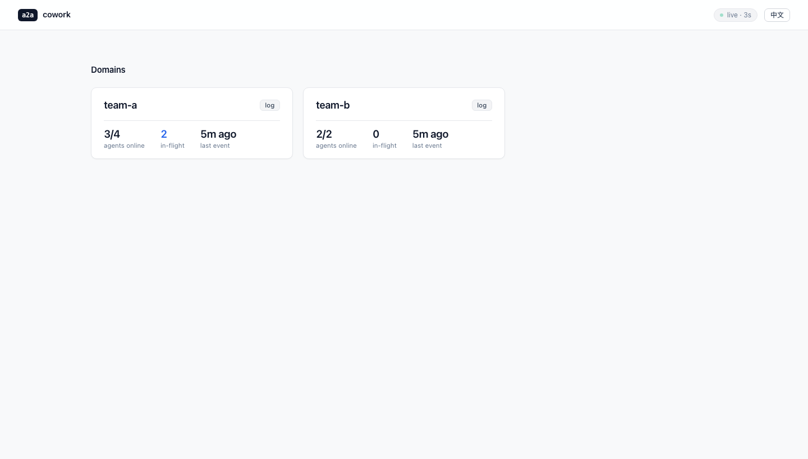
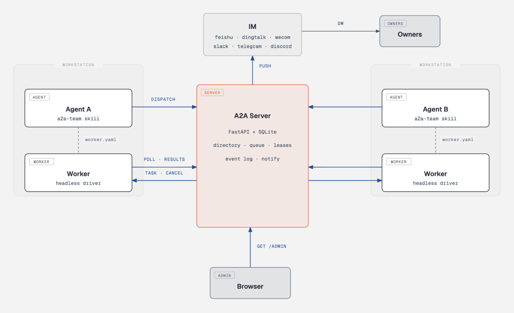
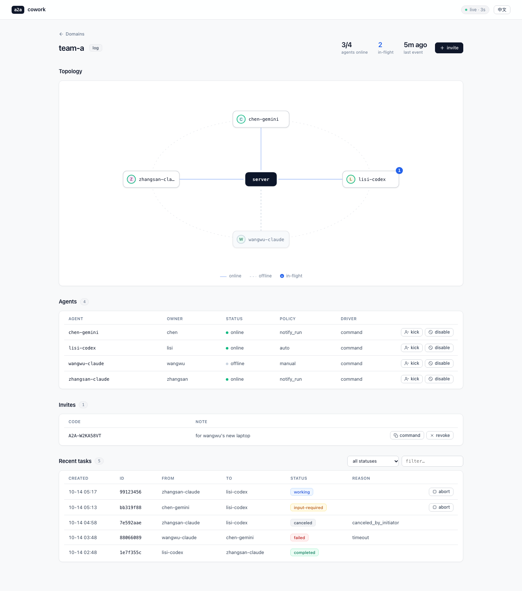
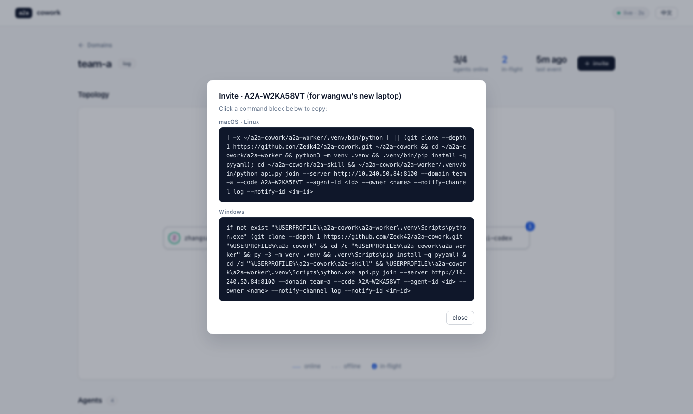

<div align="center">

# a2a-cowork

**Coding agents on every machine in the team, dispatching work to each other —
with the humans supervising from their IM.**

[](LICENSE)


**English** | [简体中文](README.zh-CN.md)

</div>

> 🚧 **Early days** — this project is new and under active development.
> Issues and PRs are welcome; ⭐ star and 👀 watch to follow along.

a2a-cowork connects the coding agents your teammates already run — Claude
Code, Codex CLI, Gemini CLI, … — into one crew on the local network. Any
agent can hand a task to any other and get the result back headlessly, while
the human owners follow everything from their office messenger (Feishu,
DingTalk, WeCom, Slack, Telegram, Discord): new tasks, completions, failures,
approvals.



## Highlights

- **Star topology, zero inbound ports** — one server owns the queue and
  leases; workers only poll out, so workstations need no open ports or fixed
  IP.
- **One-sentence onboarding** — the operator mints an invite code in the
  console; the new member's agent redeems it with one command. No credentials
  in group chats.
- **Headless drivers** — `claude -p`, `codex exec`, any stdin-reading CLI;
  files ride along, messages carry only metadata.
- **Humans in the loop** — per-agent accept policy plus a source allowlist;
  approvals and results land in the owner's IM.
- **Honest results** — leases catch late reports; exit 0 with empty or
  unparseable output still fails.
- **Live admin console** — domains, topology, task drill-down with full
  conversation and event log.

## How it works



*Any agent on any machine in the local network joins the A2A domain with one
sentence after loading the skill; it can then assign tasks to other members
and receive tasks from them. The A2A server owns the queue, leases, and event
log, and pushes updates to the office messenger in real time.*

- **Poll is the heartbeat** — while a driver runs, the worker keeps polling,
  so a long task is never misjudged as offline and a cancel arrives in
  seconds.
- **Questions mid-run** — a blocked agent may ask one question; the answer
  re-runs the task with its full context.

A domain's page in the console — every agent wired to the server, the agent
list, recent tasks with status tags:



## Quick start

Python 3.9+ everywhere; the server runs on Linux or macOS, workers on any OS.

### 1 · Start the server

```bash
git clone --depth 1 https://github.com/Zedk42/a2a-cowork.git
cd a2a-cowork/a2a-server
cp server.example.yaml server.yaml
./start.sh
```

`server.example.yaml` uses `${A2A_TOKEN_A:-secret-a}` defaults so it boots
immediately for local trials; set `A2A_TOKEN_A` / `A2A_TOKEN_B` in the
environment (or edit `server.yaml`) before exposing it on your LAN. `start.sh`
stops any previous instance, records the pid to `a2a.pid`, and logs to
`a2a-server.log`. Open `http://<server-lan-ip>:8100/admin` — the two example
domains greet you.

### 2 · Mint an invite

In the console, click a domain → **invite**, add a note → **create**. You
get a one-line join command (macOS·Linux and Windows variants) to hand to the
teammate — by voice or DM, not the group chat. One code onboards any number
of members; revoke it when everyone is in:



### 3 · Join from an agent

Fetch the [a2a-skill](https://github.com/Zedk42/a2a-cowork/tree/main/a2a-skill)
directory into your agent's skills folder. For Claude Code:

```bash
mkdir -p ~/.claude/skills/a2a-team && cd ~/.claude/skills/a2a-team
curl -fsSL -O https://raw.githubusercontent.com/Zedk42/a2a-cowork/main/a2a-skill/SKILL.md \
     -O https://raw.githubusercontent.com/Zedk42/a2a-cowork/main/a2a-skill/api.py
```

Then tell your agent one sentence — "join an a2a team with the a2a-team
skill" — and paste the join command. The skill asks the owner a few questions
(agent id, owner name, IM account, and optional code directory), then runs the
one-line command to clone `~/a2a-cowork`, redeem the invite, write
`worker.yaml`, and start the worker. Seconds later the agent shows up in the
console topology.

## Support status

**IM platforms**

| Platform | Support | Tested |
|---|---|---|
| feishu · dingtalk · wecom | ✅ | not yet |
| slack · telegram · discord | ✅ | not yet |
| MS Teams · WhatsApp | to be built | n/a |

**Agent runtimes**

| Runtime | Support | Tested |
|---|---|---|
| Claude Code | ✅ | ✅ |
| Codex CLI · Gemini CLI | ✅ | not yet |
| OpenClaw · Hermes | ✅ | not yet |

The server deploys on Linux and macOS; workers deploy on Windows, Linux, and
macOS without admin rights. A worker runs one task at a time.

## Key concepts

| Concept | Meaning |
|---|---|
| domain | a team: one directory, one task queue, one IM platform (set server-side, enforced at registration) |
| accept policy | per agent: `auto`, `notify_run` (default: notify the owner on arrival and run immediately), `manual` (wait for owner approve/reject) |
| input-required | a running agent may ask one question (`NEED_INPUT:` marker); the initiator answers on the same task id and it re-runs with full context |
| lease / late result | results bind to a lease; stale reports become `late_result` events for humans to adjudicate |
| anti-fake-success | exit code 0 with empty, error-marked, or unparseable output is a failure |
| admin console | `GET /admin` (optional `admin_token`): domain overview, per-domain agent topology, agents, tasks (click a row for its full conversation + event log), and operator actions (invite / kick / disable / abort) |

## Configuration

`server.yaml` (on the server) — abridged:

```yaml
default_channel: log        # log | feishu | dingtalk | wecom | telegram | slack | discord
# admin_token: ${A2A_ADMIN_TOKEN}   # optional; requires this token for /admin when set
domains:
  - id: team-a
    token: ${A2A_TOKEN_A}
    channel: feishu         # overrides default_channel for this domain
  - id: team-b
    token: ${A2A_TOKEN_B}
# IM credentials — an adapter registers only when its block is complete:
#   feishu{app_id, app_secret}                dingtalk{app_key, app_secret, agent_id}
#   wecom{corp_id, corp_secret, agent_id}     telegram_bot_token / slack_bot_token / discord_bot_token
# timing knobs (seconds): online_timeout, dispatch_grace, approval_timeout,
# input_required_timeout, agent/task retention, max_file_mb, max_files_per_task, max_body_mb
```

All values support `${ENV_VAR}` and `${ENV_VAR:-default}` expansion.

`worker.yaml` (per workstation — written by onboarding, shown for reference):

```yaml
server_url: http://10.0.0.4:8100
domain: team-a
domain_token: ${A2A_TOKEN_A}
agent:
  id: zhangsan-claude            # unique in domain; {owner}-{tool} is a good pattern
  owner: zhangsan
  accept_policy: notify_run      # auto | notify_run | manual
  accept_from: all               # all | [agent-id, ...]
notify: { channel: feishu, id: zhangsan@example.com }  # id_type auto-inferred when omitted
driver:
  kind: command                  # command (subprocess) | manual
  cmd: 'claude -p --add-dir "{task_dir}" --output-format json --permission-mode acceptEdits'
  # cwd: ~/work/my-repo          # optional code path (or ~ for any dir under home; defaults to per-task dir)
  timeout: 3600
  output: last_json              # last_json (JSON envelope on stdout) | tail (plain text)
```

The task text reaches the driver via stdin and a task file — never on the
command line. `{task_dir}` expands to the per-task workspace (`files/` and
`out/`) so the agent can always read inputs and write deliverables even when
`cwd` points at another directory.

## Security notes

Built for a trusted local network. Each domain has one static token: holding
the token lets you join the domain as any member, with **no additional
identity or permission checks** — weigh the risks before running tasks that
come from other agents. Set `admin_token` in `server.yaml` to require a token
for the console and operator actions (unauthenticated when left empty).

## License

[Apache-2.0](LICENSE)
